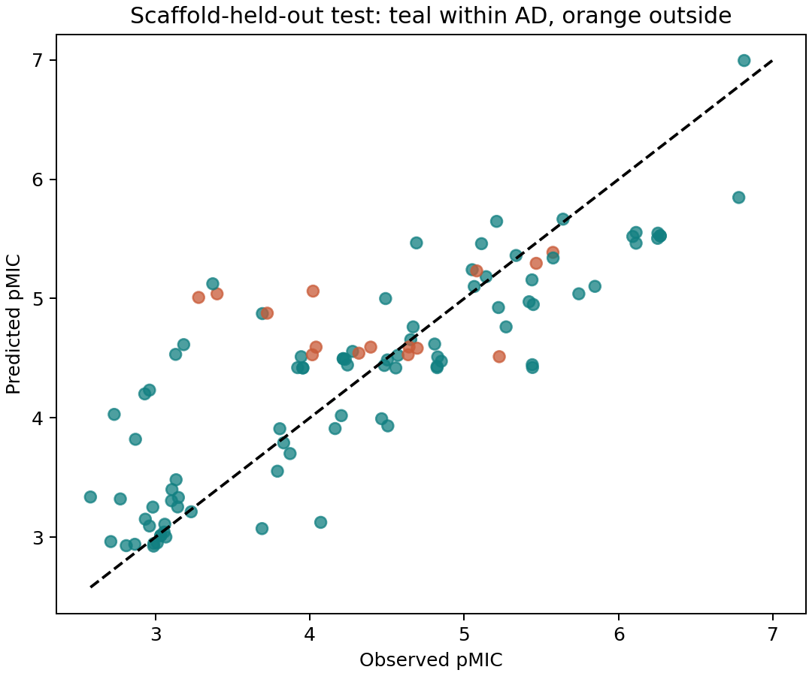
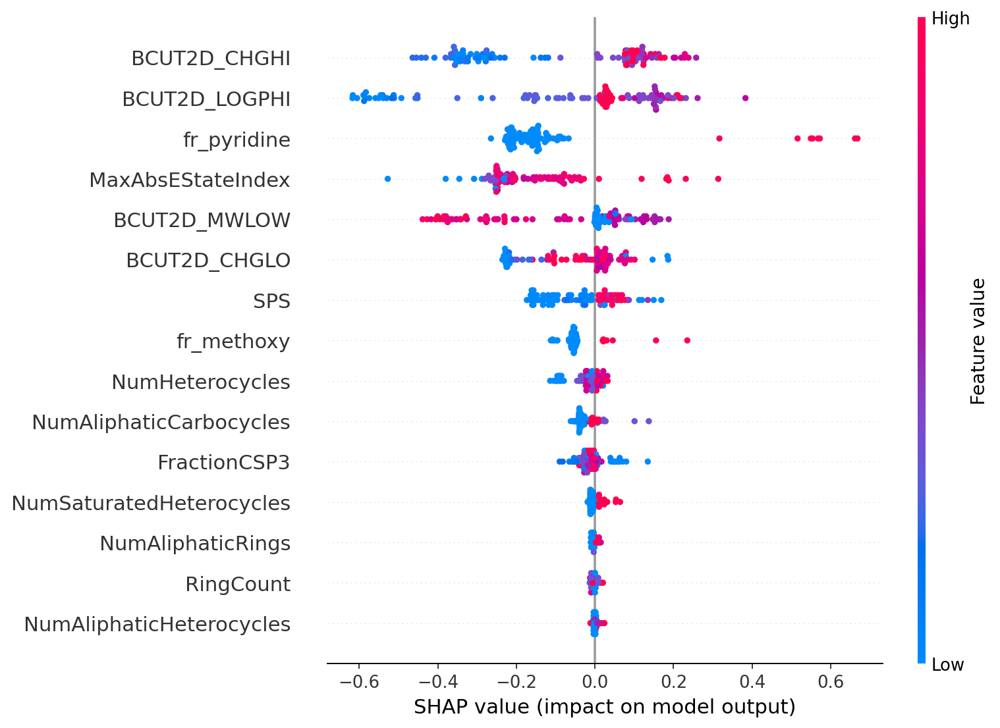
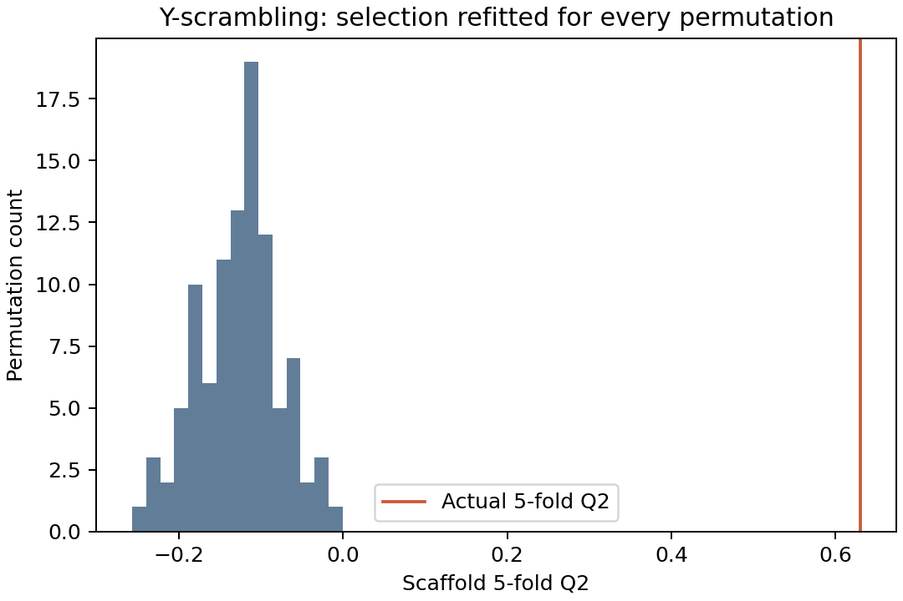
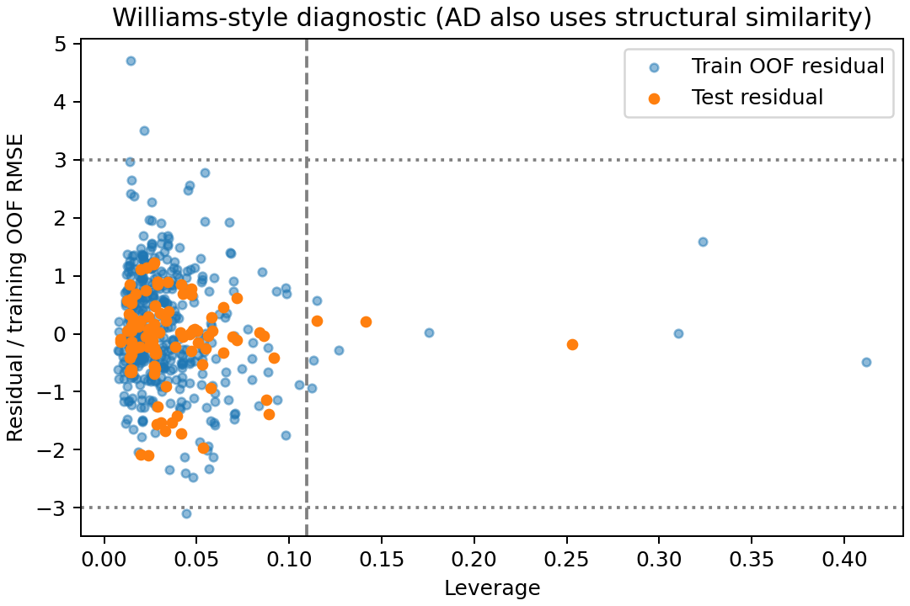

# Antibacterial QSAR results

**S. aureus ATCC 29213; pMIC regression; fixed scaffold-held-out test.**

| Requested metric | Result |
|---|---|
| Molecules : selected descriptors | 542 : 15 overall; 439 : 15 fitted (29.27:1) |
| Descriptor elimination | 217 initial -> 15 selected; refitted within each CV fold/permutation |
| Test R² | 0.6796 |
| Test RMSE / MAE (pMIC) | 0.6107 / 0.4449 |
| 5-fold CV Q² (pooled OOF) | 0.6303 |
| 10-fold CV R² (mean ± sample SD) | 0.2782 ± 0.4051 |
| Bootstrap 95% CI for test R² (n=1000) | 0.4440 to 0.7886; scaffold-cluster bootstrap |
| Golbraikh–Tropsha r0² / r0'² | 0.6850 / 0.5024 |
| Golbraikh–Tropsha k / k' | 0.9823 / 0.9991 |
| Pearson r² (distinct from predictive R²) | 0.6867 |
| Y-scrambling cR²p | 0.5576 |
| Actual Q² / mean scrambled Q² | 0.6303 / -0.1264 |
| Y-scrambling permutation p (100 repeats) | 0.0099 |
| Test compounds within AD | 85.44% (88/103) |

## Interpretation and limitations

The RF outperformed the predefined Ridge baseline (test R² 0.392) and training-mean predictor. However, the 10-fold scores range from -0.478 to 0.741, with two negative folds: transfer to new scaffolds is uneven. The test confidence interval is conditional on this fitted model.

The stated directional-OR Golbraikh–Tropsha diagnostic passes, while the reverse-direction relative discrepancy is 0.268 and does not individually meet 0.1. cR²p exceeds 0.5. These are conventional diagnostics, not OECD certification.

The scaffold split has zero scaffold overlap but 24 shared source documents. Assay protocol metadata are not fully harmonized. The model remains a research baseline; no prospective, independent-study or regulatory validation is claimed.

## Figures and evidence

[Full metrics](results/reference/metrics.json), [test predictions](results/reference/test_predictions.csv), [CV predictions](results/reference/cv_predictions.csv), [bootstrap replicates](results/reference/bootstrap_r2.csv), [permutations](results/reference/y_scrambling.csv), [selected descriptors](results/reference/selection_audit.json), [SHAP audit](results/reference/shap_audit.json), [OECD evidence map](docs/OECD_MODEL_CARD.md).
