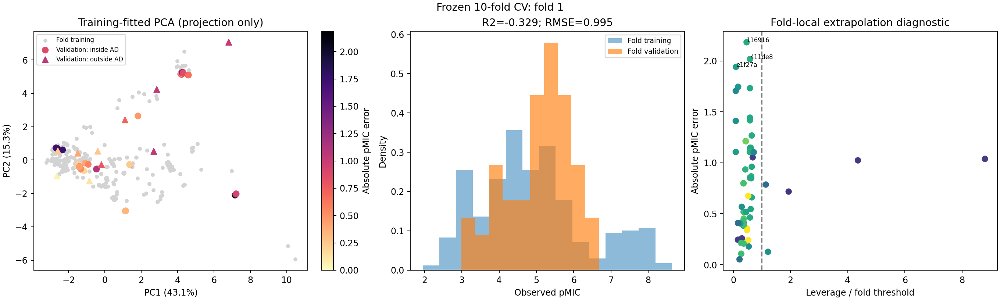
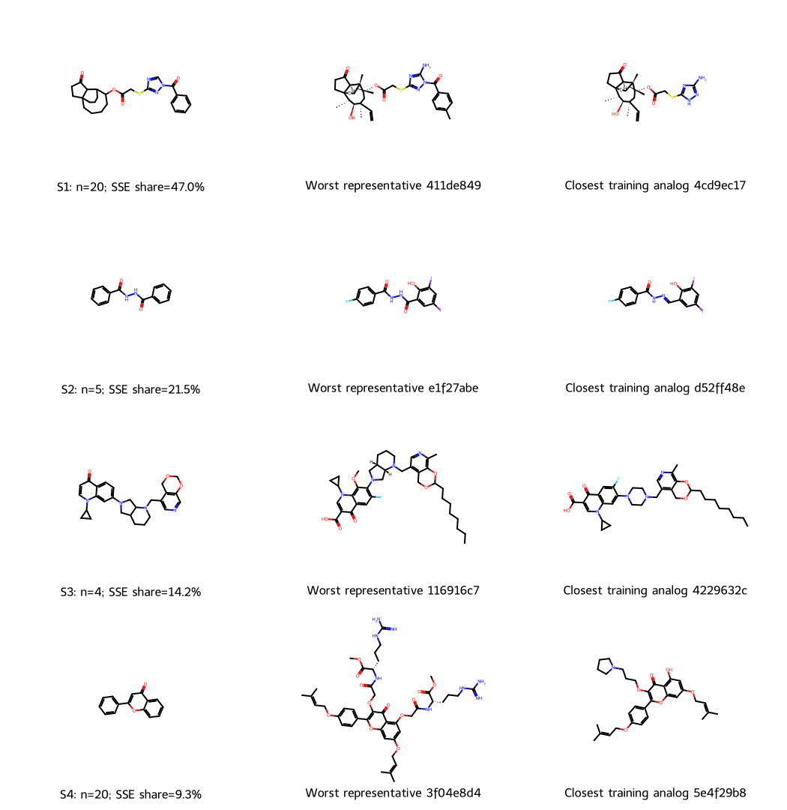
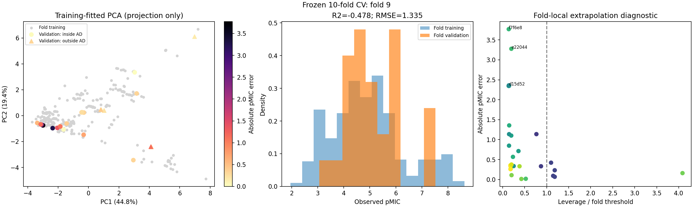
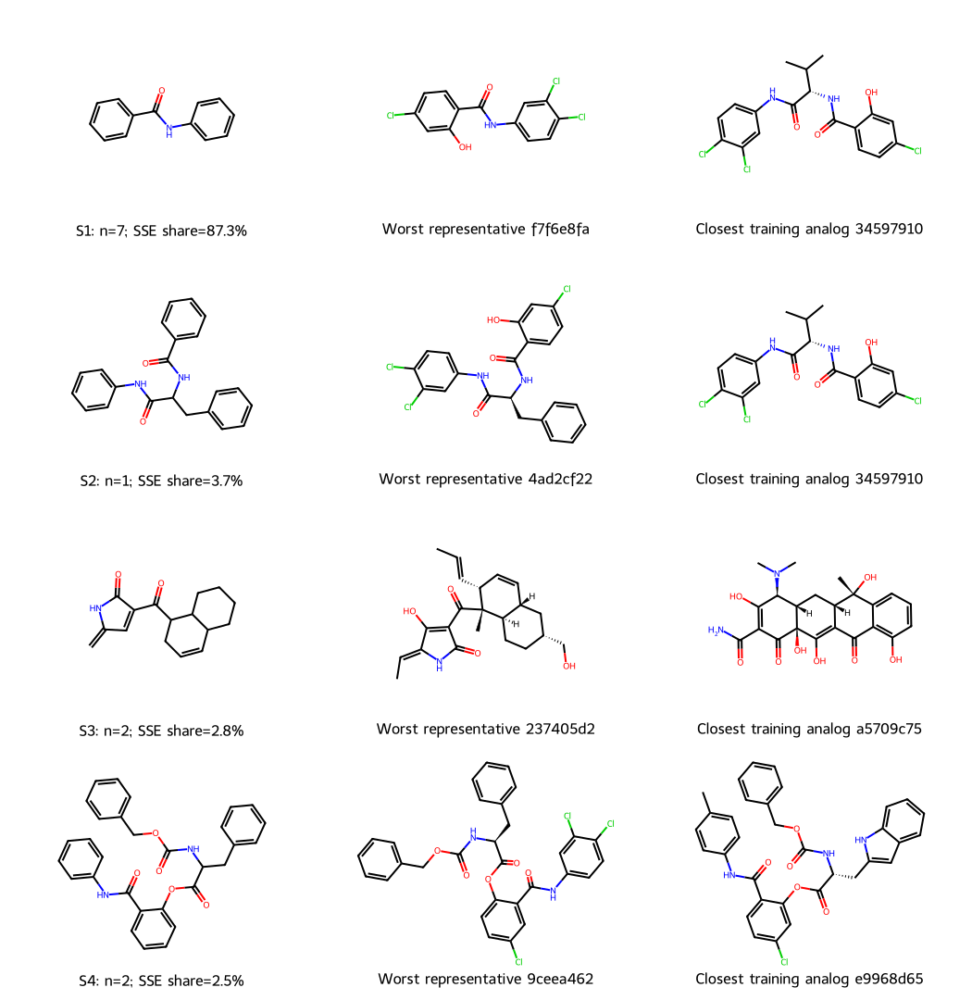

# Negative-fold diagnosis: where scaffold transfer fails

The two negative folds are **1 and 9** (one-based numbering). Most of their squared error occurs **inside the existing applicability domain (AD)**. This is evidence of limitations in local structure–activity transfer that the current AD rule does not detect; it is not explained simply by distant descriptor-space outliers.

This is a post-hoc diagnosis of the frozen training-set CV, not a new validation experiment or an improved model. All 439 training compounds were examined across the ten folds. The 103-compound external test was excluded from fitting and diagnostic calculations. No compounds were removed, hyperparameters changed, or reported scores replaced.

## Fold-level evidence

| Quantity | Fold 1 | Fold 9 |
|---|---:|---:|
| Validation compounds / scaffolds | 61 / 15 | 28 / 14 |
| R² | -0.3292 | -0.4780 |
| RMSE / MAE (pMIC) | 0.9947 / 0.8539 | 1.3348 / 0.8816 |
| Mean error (predicted − observed pMIC) | -0.2340 | -0.5420 |
| Validation pMIC variance | 0.7444 | 1.2054 |
| Training-mean predictor RMSE | 0.8832 | 1.1304 |
| Inside AD | 51/61 (83.61%) | 21/28 (75.00%) |
| Fraction of squared error inside AD | 92.23% | 96.63% |
| MAE inside / outside AD | 0.9092 / 0.5716 | 1.0589 / 0.3498 |

R² = 1 − MSE / Var(y_validation), using population variance. A narrow activity distribution can make R² negative despite a moderate absolute error. For comparison, fold 8 has a larger RMSE than fold 1 (1.0505 versus 0.9947), but R² = 0.6600 because its pMIC variance is much larger (3.2456 versus 0.7444). Nevertheless, **both negative folds also perform worse than the deployable training-mean predictor**. Their failure is not solely an R² denominator effect. See the [scikit-learn metric definition](https://scikit-learn.org/stable/modules/generated/sklearn.metrics.r2_score.html).

## Chemical series carrying the error

These are exact held-out Bemis–Murcko scaffold groups. Chemical series names describe the observed structures and source publications; they are not claims about every molecule in the wider class. Negative bias means predicted pMIC is too low, hence potency is underestimated.

| Fold / figure group | Structural series | n | MAE (pMIC) | Mean error | Share of fold squared error | Inside AD |
|---|---|---:|---:|---:|---:|---:|
| 1 / S1 | N-acylated triazole-containing pleuromutilin derivatives | 20 | 1.1409 | -1.1409 | 47.00% | 100% |
| 1 / S2 | Iodinated 1,2-diacylhydrazines | 5 | 1.5830 | +1.5830 | 21.47% | 100% |
| 1 / S3 | Fluoroquinolone–pyridoxine derivative scaffold | 4 | 1.3862 | +1.3862 | 14.22% | 100% |
| 9 / S1 | Halogenated salicylanilides (benzanilide scaffold) | 7 | 2.2984 | -2.2984 | 87.33% | 100% |

The first three groups account for **82.69% of fold 1 squared error**. Fold 9 is dominated by just seven salicylanilides. This concentration is useful for identifying a limitation, but seven related compounds from one paper do not establish a universal chemical failure rule.

The structural analog panels show each scaffold, its worst predicted representative and its closest *fold-training* ECFP4 analog. For the fold-9 salicylanilide representative, the closest analog contains an intervening amino-acid-derived linker. In fold 1, the diacylhydrazine representative is compared with a hydrazone-containing analog. Similar global descriptors and moderate fingerprint similarity therefore do not establish equivalent local chemistry. These are hypotheses for the observed transfer error, not proof of an activity cliff or a causal mechanism.

Source-series identification was checked against ChEMBL document metadata and the structures:

- Pleuromutilins: [CHEMBL4814060](https://www.ebi.ac.uk/chembl/api/data/document/CHEMBL4814060.json), [original study](https://doi.org/10.1016/j.bmc.2021.116138).
- Diacylhydrazines: [CHEMBL4811275](https://www.ebi.ac.uk/chembl/api/data/document/CHEMBL4811275.json), [original study](https://doi.org/10.1016/j.bmc.2021.116209).
- Fluoroquinolone derivatives: [CHEMBL5634112](https://www.ebi.ac.uk/chembl/api/data/document/CHEMBL5634112.json), [original study](https://doi.org/10.1016/j.ejmech.2023.115798).
- Salicylamide derivatives: [CHEMBL2434928](https://www.ebi.ac.uk/chembl/api/data/document/CHEMBL2434928.json), [original study](https://doi.org/10.1016/j.bmc.2013.08.029).

## Descriptor-space position and AD distances

Descriptor selection and scaling were refitted using each fold's training partition. All folds selected 15 descriptors. AD used the original conjunction: leverage ≤ 3(p+1)/n and nearest ECFP4 Tanimoto ≥ the fold-training leave-one-out nearest-neighbor 5th percentile. No validation responses were used to set thresholds.

An additional diagnostic measures nearest-neighbor Euclidean distance in the selected, standardized descriptor space, divided by √p. Its normalized ratio uses the fold-training leave-one-out distance 95th percentile as denominator. **This extra distance does not alter the predefined AD.** Ratios above 1 indicate greater distance than that reference percentile.

| Threshold | Fold 1 | Fold 9 |
|---|---:|---:|
| Leverage h* | 0.126984 | 0.116788 |
| Minimum nearest-training Tanimoto | 0.413043 | 0.332065 |
| Descriptor NN distance 95th percentile | 0.509902 | 0.502142 |

| Error-dominant group | Mean nearest Tanimoto | Maximum h/h* | Median descriptor NN distance ratio |
|---|---:|---:|---:|
| Fold 1 / S1 | 0.6109 | 0.6447 | 0.1692 |
| Fold 1 / S2 | 0.5255 | 0.1707 | 0.1321 |
| Fold 1 / S3 | 0.6643 | 0.4644 | 0.0458 |
| Fold 9 / S1 | 0.5632 | 0.1981 | 0.1752 |

These high-error series have low leverage and short descriptor distances. Their moderate structural similarity still clears the data-derived AD thresholds. Thus being inside this AD is not a guarantee of reliable predictions for a novel scaffold.

PCA was separately fitted to each fold's training descriptors. Its first two components explain 58.49% (fold 1) and 64.20% (fold 9) of variance. The plots are projections for visualization; full-dimensional distances and the original AD determine the numerical conclusions. Fold-specific axes are not directly comparable. In each figure, the left panel colors absolute errors and marks AD membership; the right panel colors nearest-training Tanimoto on a 0–1 viridis scale (purple to yellow). Annotated IDs mark the three largest errors.









## Interpretation and limits

The frozen model has identifiable local transfer failures even when its AD accepts a molecule. Descriptor representation, the learned regression function, and unharmonized experimental context are plausible contributors. Source-paper overlap and nearest-analog activity differences are provided per compound; this analysis does not separate scaffold effects from study effects. Ranking groups by squared error is descriptive and post-hoc, without multiplicity-adjusted inference.

This evidence supports the applicability-domain and predictivity limitations in the [OECD evidence map](OECD_MODEL_CARD.md); it does not confer OECD certification. A future model comparison should predefine structural representations, training-only uncertainty/AD calibration and study-grouped validation. Those choices must be evaluated without optimizing against the existing external test. The present analysis changes no model or score.

## Reproduce and inspect

From the repository root, after installing `qsar/requirements.txt`:

```bash
python qsar/scripts/analyze_cv_failures.py --output qsar/results/cv_failure_analysis_reproduced
python qsar/scripts/validate_cv_failures.py
```

The output directory must not already exist. The second command validates the committed archive against its hashes, original predictions, fold membership, AD flags and error totals. Reproduction refits ten frozen pipelines and asserts agreement with every archived prediction (maximum observed discrepancy < 1e-14). Small numeric or image differences across platforms are possible; archive checksums verify committed evidence rather than promising byte-identical regeneration.

- [Fold summary](../results/cv_failure_analysis/fold_summary.csv): all ten folds, baselines, activity variances and AD breakdown.
- [Compound diagnostics](../results/cv_failure_analysis/compound_diagnostics.csv): residuals, distances, nearest analog IDs/structures, activity gaps and source overlap.
- [Scaffold diagnostics](../results/cv_failure_analysis/scaffold_diagnostics.csv): group sizes, error direction, error share, AD and representatives.
- [Fold audit](../results/cv_failure_analysis/fold_audit.json): training/validation IDs, fold-selected descriptors and thresholds.
- [PCA coordinates](../results/cv_failure_analysis/negative_fold_pca_coordinates.csv), [fold 1 loadings](../results/cv_failure_analysis/fold_1_pca_loadings.csv), [fold 9 loadings](../results/cv_failure_analysis/fold_9_pca_loadings.csv).
- [Evidence manifest](../results/cv_failure_analysis/manifest.json).
